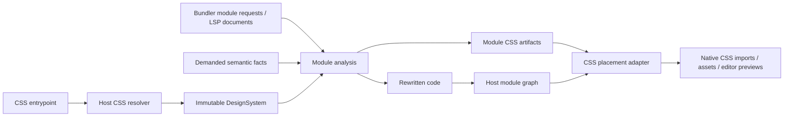

# モジュールグラフとCSS出力のアーキテクチャ調査

調査日: 2026-09-10。後述の最小実験をVite+・Next/Turbopack・Rspackで実行済み。Stillwind本体のVite統合は第一段階を実装済み。各frameworkテンプレートの受け入れ試験は未実施。
ローカル実装の確認時点は `48e0029`。本文のAPI名は、既存コードとして明示したものを除き仮称。

## 実装第一段階（2026-09-10）

実験で確認したCSS先行loadの欠落を、本物のStillwind Vite adapterで解消した。

- `DesignSystemSnapshot::render_module_stylesheet`を追加。producerのruleと必要なtoken・keyframes・propertyを出力し、Preflightとauthored global CSSを含めない。
- Node APIは`baseCss()`と`moduleCss(module)`を公開。既存の`css()`は選択済みmoduleを集約する明示APIとして残す。
- Viteの`virtual:stillwind.css`は基盤CSSだけを返す。生成JSは基盤CSSを先にimportし、その後でCSS本文をbase64url queryに含むmodule carrierをimportする。carrierのloadはsession/Mapを参照しない。
- CSS依存の編集時は、JS/classの変換が同じ場合もproducerを無効化し、新しいCSS payloadへ更新する。macro削除ではimportが消える。
- `classIdentity: 'module' | 'content'`と`classNamespace`を実装。Viteはmoduleを既定とし、低水準Rust APIはcontentを既定として既存の明示集約を維持する。module identityにはproject-relativeなproducer pathを使用し、SSR/clientで異なるsaltは加えない。
- `tailwindcss` importのStillwind alias扱いを削除。parity試験だけは上流fixtureの入力をStillwind entryへ明示変換する。
- 通常CSSのimportはnamed/anonymous layer、supportsの宣言・function・boolean条件、mediaを保持する。順序違反、空layer、未対応の`prefix`等は診断する。既存Stillwind selectorのconditional/anonymous-layer importは正しく出力できないため、今回から黙殺せず診断する。

本体のVite build試験は遅延producer・dynamic import・未到達source・global CSS重複を検査する。Chromeでは本物のmacroによる表示、CSS編集でのclass維持、macro削除・復元を確認。再実行は`packages/vite`で`vp run test`、その後`experiments/module-graph`で`vp run verify:stillwind`。後者の結果は`results/stillwind.json`。ページreloadは許容しており、状態を保持するHMRの保証ではない。

次の段階に残るもの: `packages/react`からcore packageへの移動、RustのCSS埋め込みとStillwind import特殊扱いの完全撤去、source由来URL/source mapの移送、意味probeに応じた依存読取への縮小、environment別session、Next/Rspackの本体adapter。これらは今回のVite輸送変更で完了したとは扱わない。

CSSエントリ移行時の確定方針: `@import "stillwind"`はpackage exportsで公開する（現在のexportsにも存在）。`tailwindcss`のalias互換は復活させない。importの修飾子と出力位置を保持し、未対応の組合せは診断する。utilitiesの配置マーカーが必要なら`@stillwind-slot utilities;`を使用する。今回のmodule carrierにはこのマーカーを追加していない。

## 実測による結論

2026-09-10にWindows上で18項目の実験チェックを実施した。ハーネス・固定lockfile・再実行手順・JSON結果は `experiments/module-graph/` に保存している。再実行はそのディレクトリで `vp i --frozen-lockfile`、`vp run verify`。基礎となる環境はNode 24.21.0、Vite+ 0.3.1、Next 16.3.4、Rspack 2.2.3、React 19.2.8、Playwright 1.63.0とインストール済みChrome。

実験は `styleToken('CSS宣言')` という小さな代理マクロを使い、モジュール変換とCSS輸送を検証したもの。Stillwindの構文解析・型推論を実行した結果ではない。

| 実験                      | 実測結果                                                                                                                               | 設計への反映                                                   |
| ------------------------- | -------------------------------------------------------------------------------------------------------------------------------------- | -------------------------------------------------------------- |
| Vite buildでCSSを先行load | 集約CSSのload時点で350ms遅延moduleが未登録となり、そのCSSが成果物から欠落。negative controlとして再現                                  | `load → 現時点のsession.css()`だけで本番CSSを確定しない        |
| Vite module CSS carrier   | 同じ遅延moduleとdynamic importのCSSが出力され、初期/lazyの2 CSS assetに分かれた                                                        | module単位で完結するCSS importを基本経路にする                 |
| Vite dev                  | 初回はfast/slowだけがtransform対象。クリック後にlazyを処理。未到達moduleは対象外。編集後の色変更とmacro削除後のclass除去をChromeで確認 | runtime対象はホストの要求に従う。全JS再帰走査は必要ない        |
| Next dev                  | RSCとClient Componentの色をChromeで確認。未訪問lazy routeと未importファイルのloader実行なし。lazy route訪問後に正しい色                | Nextの通常のmodule/CSS経路に載せられる                         |
| Next CSS依存変更          | `fs.readFile` / `addDependency`で登録したtheme代理ファイルを編集し、ページを手動再読込せず色の変更を確認                               | CSS定義依存をproducer変換の依存として登録する                  |
| Next production           | 初回production buildと別Nodeプロセスでの再buildが成功。両方を起動しRSC/client/lazyのcomputed colorを確認                               | query内のCSS payloadでworker間shared Mapを不要にできる         |
| Next warm cache           | 初回production buildのJS loader実行6回、次のbuildは0回。それでも本番表示が正しい                                                       | transform副作用でCSS寄与を再収集する方式を正しさの条件にしない |
| Rspack persistent cache   | 初回main/lazyのloader実行2回、別processのwarm buildは0回。両方のCSSがcurrent chunkに存在                                               | Native CSS chunkingと復元可能なcarrierの組合せが成立           |
| Rspack依存変更            | theme代理ファイルの変更でloaderが再実行され、main CSSのcontent hashと宣言値が変化                                                      | cacheを維持したまま依存無効化が可能                            |
| salt相当のselector分離    | CSS順を逆転しても別要素の色は同じ。同じ要素に両classを合成すると色が変わる                                                             | 通常の分離を初期保証にし、明示compositionの順序を別契約にする  |

CSS carrier方式を推奨から**最小統合で成立した基本案**へ進める。graph全体を読む最適化は、この動作経路に付加する。global placeholderの後段置換そのものは今回実装していないため、代替案として残す。

初回Next実験ではWindowsのdrive付き絶対pathをCSS importへ出して `windows imports are not implemented yet` で失敗した。producerからcarrierへの相対specifierへ変更して成功。生成importはmodule resolverが理解するspecifierを使用し、filesystemの絶対pathをそのまま流さない。

結果の読み方: `vite-build-aggregate` のPASSは「欠落するというnegative controlが再現した」という意味。Nextのcoldは新規fixtureのdev実行後、最初のproduction build。Rspackはcurrent chunkのassetを検査しており、出力先に残った古いCSSを成功根拠にしていない。

この実験から保証しないもの: 本物のmodule salt実装、型依存の読み取り量、LSPの未保存buffer、source map、CSS内URL、Shadow DOM、全template、Nextのclient-router遷移/prefetch/streaming、RspackのブラウザーHMR。Viteの編集反映はページreloadを許しており、UI状態を保持するHMRの保証ではない。これらは独立した次の受け入れ試験にする。

## 推奨する境界

CSSエントリポイントからDesignSystemを完全に構築する。その後、ホストが処理するJS系モジュールについて、必要な意味情報を取得し、マクロを置換してモジュールごとのCSS artifactを返す。集約・配置・最適化は別の処理とする。

**全体のCSS最適化には全体の使用情報が必要だが、個々のモジュールの変換とCSS生成まで全体完了に依存させる必要はない。** 生成名も到着順や全体の使用集合に依存させない。

バンドラーの全モジュールグラフ取得・完了hookは追加能力として扱う。すべてのホストで必須にすると、遅延開発サーバー、LSP、Turbopackへの適用が難しくなる。

図のgraphから配置への入力は、ホストが公開する範囲だけを使う。CSSをloadする処理からgraph全体の完成を待つ依存は作らない。

## 参考実装から分かったこと

### Tailwind CSS

現在のTailwindはソースをテキストとして走査する。v4.3.3のVite実装にも `Scanner({ sources })` と `scanner.scan()` があり、JSのimport bindingを解析するコンパイラーではない。初期v4のmodule graphに関する説明を、そのまま現在の実装に当てはめるべきではない。

参考になるのは、CSSをcompileして再利用可能な状態を作り、収集したcandidateを別途渡す境界。ファイル走査方式は、今回の「実際のバンドラー対象を解析する」要件の根拠にはならない。

根拠: [source detection](https://tailwindcss.com/docs/detecting-classes-in-source-files)、[Vite v4.3.3 source](https://github.com/tailwindlabs/tailwindcss/blob/v4.3.3/packages/@tailwindcss-vite/src/index.ts)。

PostCSS以外の統合も存在する。v4.3の公式記事は専用webpack loaderとTurbopackへの適用を説明している。また調査時の公開registryで `@tailwindcss/turbopack@4.3.3` を確認した。専用loaderにしても、そのソース収集はfilesystem scannerであり、JS graphを取得する仕組みにはならない。

根拠: [v4.3 announcement](https://tailwindcss.com/blog/tailwindcss-v4-3)、[Turbopack source snapshot](https://github.com/tailwindlabs/tailwindcss/blob/41d9cae8e53378d16087fcf359eb785c2fd42ce4/packages/@tailwindcss-turbopack/src/index.ts)。後者は固定したrepository snapshotであり、公開tarballとの同一性は検証していない。

### Lingui

記憶にある機能は実在する。dependency-tree extractorはv4からの実験機能で、最近の変更はv6.5.0（2026-07-06）のpluggable bundler interfaceとRolldown対応。v6.6.0の公開commitでも確認できた。

処理は、指定entryを別途bundleし、chunkを解析してmessageを抽出し、chunkのstatic/dynamic importを辿ってentry別catalogへ帰属させるもの。アプリのVite/Nextビルドのgraphを直接購読しているわけではない。

参考にするのは「モジュール解析結果とentryへの帰属を分けること」「共有chunkを一度解析して複数entryへ関連付けること」。別バンドルを常時起動する方式は、開発時の最小読み取りや、フレームワーク固有のresolve条件との一致には不利。

根拠: [dependency tree guide](https://lingui.dev/guides/message-extraction#dependency-tree-crawling)、[6.5.0 changelog](https://github.com/lingui/js-lingui/blob/665a19815378dedd89346bb7707bdb0e28df79e7/CHANGELOG.md)、[Rolldown adapter](https://github.com/lingui/js-lingui/blob/665a19815378dedd89346bb7707bdb0e28df79e7/packages/cli/src/extract-experimental/bundlers/rolldown.ts)、[chunk attribution](https://github.com/lingui/js-lingui/blob/b3934fc7332c479cfa1811305374973d3e8272ab/packages/cli/src/extract-experimental/buildChunkGraph.ts)。

### vanilla-extract

今回最も近い参考例。Turbopack loaderはモジュールからJSとCSSを作り、serialized CSSをqueryに含む `vanilla.virtual.css` のimportを生成する。CSS側のloaderがqueryを復元してCSSを返す。これにより、CSS出力の正しさを「先に全モジュールがshared Mapへ登録されていること」に依存させずに済む。

Next pluginには `as: '*.css'` の設定がある。ただし統合は `unstable_turbopack` とされ、調査したsourceでは既定off。内部にはViteベースの評価コンパイラーもあるため、Stillwindへ移すべきなのはCSSの受け渡し方であり、別Vite graph全体ではない。

根拠: [Turbopack loader](https://github.com/vanilla-extract-css/vanilla-extract/blob/881c256a867f55386f96a7fe95068300bac720e6/packages/turbopack-plugin/src/index.ts)、[Next integration](https://github.com/vanilla-extract-css/vanilla-extract/blob/881c256a867f55386f96a7fe95068300bac720e6/packages/next-plugin/src/index.ts)。公開registryのloader versionは0.1.4。参照sourceは固定したrepository snapshot。

### UnoCSS

global、per-module、dist-chunk、shadow-domの出力方針が既に分かれている。現在のglobal build実装には、loadでplaceholderを返し、renderChunkで収集結果を生成してViteのCSS処理へ渡し直す仕組みがある。

ただし `vite:css` / `vite:css-post` を名前で探して内部hookを呼ぶ実装になっている。placeholder方式が可能という根拠にはなるが、すべてのバンドラーで同じ公開APIだけで実現できるという根拠にはならない。

根拠: [output modes](https://unocss.dev/integrations/vite)、[global build source](https://github.com/unocss/unocss/blob/47ccd42d08996b40a41ca342404107cc2e2a4c05/packages-integrations/vite/src/modes/global/build.ts)、[per-module source](https://github.com/unocss/unocss/blob/47ccd42d08996b40a41ca342404107cc2e2a4c05/packages-integrations/vite/src/modes/per-module.ts)。

## 区別する4つのgraph

| graph               | 所有・範囲                                                      | 用途                                                          |
| ------------------- | --------------------------------------------------------------- | ------------------------------------------------------------- |
| CSS定義graph        | ホストがCSS entryから全importを解決。Rustは内容とedgeを受け取る | DesignSystem、CSS依存、source span、再構築                    |
| 実行モジュールgraph | バンドラーが所有。開発時は観測範囲、本番はそのcompilationの対象 | マクロ変換の対象、runtime import、dynamic import、environment |
| 意味依存graph       | StillwindとTypeScript providerが必要な情報だけ要求              | imported handle、ref、re-export、型の取得と無効化             |
| 出力graph           | バンドラー・フレームワークが所有                                | module/chunk/routeとCSS asset、SSR manifest、preloadの対応    |

型のために読んだ `.d.ts` や補助モジュールを、自動的にCSSの出力対象に加えない。逆に、型消去されるimportがマクロの意味に必要なら、runtime graphに存在しないという理由で読み取りを禁止しない。

「graphをすべて読む」は、本番でもfilesystem全体を再走査するという意味にしない。ホストが持つ到達可能なモジュール・chunk情報を利用し、コードの再読込・再解析はrevisionが変わったものに限定する。

## 3つの実行形態

| 形態           | JS解析対象                                             | 全体完了                                | CSS                                                               |
| -------------- | ------------------------------------------------------ | --------------------------------------- | ----------------------------------------------------------------- |
| 非バンドル開発 | transform要求を受けたモジュールと必要な意味依存        | ない                                    | モジュール対応CSS、または現在の寄与集合を使った開発用集約         |
| バンドル開発   | ホストが要求したentry/routeのcompilation               | compilation単位。アプリ全体とは限らない | ホストのCSS chunk/HMRへ接続                                       |
| 本番           | build対象の全到達可能モジュール。dynamic entryも含める | ホストが保証するbuild/output境界        | 完全な集合で集約・重複排除・安全な最適化。配置はchunk/routeを保持 |
| LSP            | 開いている文書、編集buffer、必要な意味依存             | 要求しない                              | 診断・補完・部分preview。公開assetは作らない                      |

Viteは開発時に `moduleParsed` と通常のoutput hookを呼ばない。Turbopackは遅延バンドルを行う。Rspackにもlazy compilationがある。従って `dev = unbundled`、`bundled = graph complete` という二分は使えない。

根拠: [Vite plugin lifecycle](https://vite.dev/guide/api-plugin.html)、[Turbopack](https://nextjs.org/docs/app/api-reference/turbopack)、[Rspack lazy compilation](https://rspack.rs/guide/advanced/lazy-compilation)。

## 検出と解析の境界

ホストのtransform/loaderへ入ったコードを対象に、まず安価な候補判定を行い、次に構文・import bindingでマクロを判定する。単なる同名関数や、shadowingされたbindingを変換しない。

物理pathだけをmodule keyにしない。ホストのresolved ID、query、environment、frontend、source revisionを区別する。ファイルpathはsource表示・watch用の別フィールドとする。SFCの仮想moduleを将来扱うには、元ファイルへのsource mappingも必要。

`node_modules`を一律除外する契約にはしない。既定では通常の外部ライブラリを高速に除外しつつ、workspace packageやマクロを含む配布物は明示対象にできるようにする。Viteのdependency prebundleやSSR externalizationによって変換を迂回する場合は、ホスト側設定も必要。

re-exportやaliasを追う際は、export summaryや型factを必要なsymbolについて取得する。毎回すべての相対importのコードを再帰的にcompileする必要はない。意味依存の循環はsummaryの解決とcycle診断で扱い、依存先の最終CSSをawaitしない。

**任意のTypeScript型推論を使う限り、読み取り量が必ず小さくなるとは保証できない。** 型factを必要としないマクロはmodule-localに処理し、必要なprobeだけproviderへ渡す。厳密な最小読み取りが要件なら、マクロの受理する式・型の範囲、またはライブラリから公開する意味metadataの契約が必要になる。

## CSS importによる待ち合わせを避ける方法

危険な依存は `CSS load → 全JS解析完了 → CSSをimportするJSの処理完了 → CSS load`。単にCSS load内でpromiseを待つ方式は採用しない。

共通の基本形は次の順序とする。

1. CSS定義graphからDesignSystemを確定する。この段階でJS使用情報は不要。
2. モジュールAを解析し、変換コードとCSS artifact Aを生成する。
3. 必要なら変換コードにartifact Aを指す通常のCSS importを追加する。
4. CSSのloadは、そのartifactとDesignSystemだけで完了する。未処理のモジュールBを待たない。
5. 本番の集約・最適化は、そのホストで利用できる後段の出力処理で行う。

ホスト内部にCSS artifactを登録してからJSを返せる場合はvirtual moduleを使う。プロセス間でMapを共有できないloader環境では、再構築可能なpayloadや永続artifactを使う。shared singletonはキャッシュに使えても正しさの条件にはしない。CSSの相対URLは元のsourceに基づいて解決し、carrierファイルのディレクトリへ意味が変わらないようにする。

単一CSSを作るadapterではplaceholderも選択肢。ただし、graphが閉じた後にCSSを確定し、CSS minify・URL処理・source map・content hash・manifest生成との順序を保証する必要がある。最終assetの文字列だけを後から置換するのは不十分。開発時には全体完了が来ないため、この方法を共通の必須プロトコルにしない。

## CSS artifactに必要な情報

単なるCSS文字列の配列では、分割と最適化の安全性を判断できない。少なくとも以下を保持する案とする。

- 生成ruleのidentityと内容、所有module、使用しているmacro/宣言のidentity。
- theme token、keyframe、property registration、他のstyle artifactへの依存。
- layer、条件、元の定義順、順序を入れ替えられない制約。
- source spanと元URLの基準、DesignSystem revision。
- 文書全体へ作用するものか、限定されたselectorのruleかという作用範囲。

CSS entryのpreflightやauthored global CSSは、到達したというだけでmoduleごとに繰り返し挿入しない。DesignSystemの読み込みと、文書への基盤CSSの配置を分離する。

module artifactを単独で出力する際には、必要なtoken等を一緒に出力するか、依存する共有CSSへimportを張る。アプリ全体で使うtokenを一つの共有CSSへ集約する最適化は、全体集合が得られるホストの後段処理とする。得られない場合は、重複が残っても正しい依存閉包を優先する。

2026-09-10の追加方針: 通常のstyleは固有classを持ち、モジュールをまたぐ暗黙の共有を前提にしない。モジュールidentityをclass hashのsaltに加えられるようにする。この前提では、Tailwindのatomic utility全体のような厳密なglobal orderを初期対応の必須条件にしない。分割CSSの一般的な順序独立性の証明を、統合着手の条件から外す。

saltが分離するのはclassのidentity。同じ要素に異なるmoduleのstyleを明示的に合成した場合や、同じrefの対象へ複数moduleからruleを当てた場合の競合までは消えない。ただし、これは通常のCSS compositionの順序契約として扱い、初期版で任意のmodule間競合を自動解決する必要はない。keyframesやproperty等の共有名もclass saltとは別に扱う。

saltなしで同一styleを共有する集約モードは任意の最適化とする。per-moduleの順序規則を全体のrule集合に適用する方針を第一候補とし、shared classの重複排除もそこで行う。この最適化がなくても、saltありの基本統合を成立させる。

### Class identityと集約モードの案

| 機構            | 契約案                                                                                       | 状態                                               |
| --------------- | -------------------------------------------------------------------------------------------- | -------------------------------------------------- |
| module saltあり | 安定したproducer module identityとstyleの意味からclassを決める。モジュール間で暗黙共有しない | 第一段階で実装。Viteの既定                         |
| module saltなし | 同じ意味のstyleを同じclassにできる。集約時に順序を揃えて重複を省く                           | 任意の最適化。初期対応から外す選択も可能           |
| CSS配置         | module/chunk/documentへの配置                                                                | saltとは独立。saltありでもアプリ全体へbundleできる |

第一段階で `classIdentity: 'module' | 'content'` を実装し、Viteはmoduleを既定にした。同一module内の同一styleは同じ名前を共有する。低水準APIの既定はcontentであり、moduleを選ぶhostは安定した相対module identityを渡す。

saltには絶対checkout path、到着順、時刻、開発サーバーのURL、SSR/clientのラベルをそのまま使わない。プロジェクト・パッケージを区別できる安定したnamespaceと、その内部でのmodule identityを候補にする。キャッシュkeyはenvironment等を区別するが、同じ意味のstyleをSSR/clientで出力する場合のclass名は一致させる。仮想moduleの意味のあるsub-IDと一時queryも区別する。

exportしたstyleをimport先で再saltしない。producerのclass identityとCSS依存を保持し、re-exportでも同じstyleを指す。同じソース文字列でもDesignSystem・設定によって異なるCSSになる場合は、saltなしでも無条件に同じ定義とみなさない。共有判定は出力の意味・条件・依存を含める。

global orderは既存per-moduleの比較規則を共通化して適用する。比較で同順位になるものの順序は、非同期の到着順ではなく明示した安定順にする。ただし「各moduleの順序をそのまま保つ」ことと「共有ruleを一度だけ出す」ことが常に両立するわけではない。例えばmodule AがX→Y、BがY→Xを要求するなら、共有後のX/Yに両方の順序は与えられない。この場合の最適化は共有を見送る、または未対応と明示する程度でよく、一般的な競合解決を初期coreへ持ち込まない。

残す確認は、通常の別要素へのstyle適用、export/re-exportしたstyle、明示的な複数styleの合成、SSR/clientのclass一致。saltの仕様と通常利用を確認するための範囲に絞る。

Web Componentsでは、CSSがmodule単位であることとShadow Rootに適用できることも別。将来は文書CSS、CSS text、constructable stylesheet等の出力先を分け、`:root` / `:host`、preflight、継承token、property registrationの扱いを決める。公開APIの実装は後回しにできるが、単一文書への配置をcoreの前提にしない。

## バンドラー・フレームワーク統合

| 対象                              | 推奨するadapter                                  | 注意点・検証事項                                                                           |
| --------------------------------- | ------------------------------------------------ | ------------------------------------------------------------------------------------------ |
| Vite                              | transform + virtual CSS + environment単位の状態  | JSX lowering前の解析、複数environment、SSRのCSS対応、HMR                                   |
| Remix v2 / React Router framework | Vite adapter + framework固有の出力接続           | server-onlyコード、route split、SSR初回HTMLへのCSS。世代を区別する                         |
| SolidStart                        | Vite adapter + Solid frontend                    | SolidのJSX変換前に処理。v2は直接Environment APIを利用、旧v1は別構成                        |
| TanStack Start                    | ViteとRsbuild/Rspackのadapter                    | client/server、server functions、route split。現在は両ビルドツールが公式対象               |
| Next.js / Turbopack               | Next設定wrapper + JS loader + CSS carrier loader | RSC/client/server/edge、CSS carrier、persistent cache、CSS依存追跡                         |
| Next.js / webpack                 | 同じNext wrapperからwebpack adapter              | Turbopackと別に検証。webpack設定だけではTurbopackへ適用されない                            |
| Rspack / Rsbuild                  | JS loader + plugin、必要ならRsbuild wrapper      | module/chunk graphを利用。read-only hookでmoduleを書き換えようとしない                     |
| 将来: SvelteKit / Nuxt / Astro    | 対応frontend + 主にVite adapter                  | SFC/仮想moduleの入力段階、source mapping、server/islandのCSS。Vite対応だけで完了とはしない |

Viteは同一plugin instanceを複数environmentで共有するため、状態を分離する必要がある。SSRでだけ使われるマクロでもブラウザー向けCSSは必要になり得る。したがって「client graphの分だけCSSを出す」は不十分で、frameworkのrender/routeとassetの対応を尊重する。

根拠: [Vite Environment API](https://vite.dev/guide/api-environment-plugins)、[React Router styling](https://reactrouter.com/explanation/styling)、[SolidStart v2 announcement](https://github.com/solidjs/solid-start/discussions/2281)、[TanStack Start Rsbuild support](https://tanstack.com/blog/start-adds-rsbuild-support)。

Rspackには `finishModules`、chunk関連hook、`processAssets` がある。ただし `finishModules` はmodule構築の完了であり、tree-shaking後の最終使用集合ではない。また多くのhookはread-only。変換はloaderで行い、graphの観測・assetへの接続をpluginへ分ける。

根拠: [Rspack compilation hooks](https://rspack.rs/api/plugin-api/compilation-hooks)。

Turbopackは調査したNext v16.3.4の説明でも `emitFile`、`loadModule`、`importModule` が未対応。webpack plugin相当の全graph/finalize機構を利用できるとは確認できなかった。基本動作はmodule単位で完結させ、ネイティブのCSS bundlingへ渡す案が適している。

注意すべき資料差異がある。同じNextドキュメントに「JSを返すloaderのみ対応」という記述が残る一方、vanilla-extractとNext自身のテストにはCSS loader経路がある。今回さらにNext 16.3.4で正常なCSS query carrier、依存更新、別processのwarm buildを実測し成功した。この対象版ではCSS carrier方式を採用可能と判断する。Stillwind本体の意味情報・source map・URLを含む統合は別途検証する。

根拠: [Next v16.3.4 documentation source](https://github.com/vercel/next.js/blob/v16.3.4/docs/01-app/03-api-reference/05-config/01-next-config-js/turbopack.mdx)、上記vanilla-extract / Tailwindの参照。

## PostCSSの判断

初期対応では専用PostCSS pluginを必須にしない。PostCSSはCSS変換の入口にはなるが、JSマクロの置換やバンドラーの実行graphを取得する入口にはならない。shared registryをCSS処理から参照するだけでは順序・worker・cacheの問題が残る。

Nextの公式導入手順には今もTailwindのPostCSS設定があるため、「PostCSSはもう使われない」という需要判断はしない。ただしStillwindの初期統合はNext wrapper + bundler adapterを優先する。将来、事前生成したartifactを受け取るCSS処理用adapterとして追加する余地を残す。

根拠: [Next CSS guide](https://nextjs.org/docs/app/getting-started/css)。

## 共通APIに残す情報と能力

概念上、`analyzeModule` / `compileModule` がartifactを返し、`planStylesheets(selection, placement)` が出力を計画する。実行環境が完全か部分的かをartifact自体の真偽と混同しない。

| 情報・能力                   | 意味                                                                     |
| ---------------------------- | ------------------------------------------------------------------------ |
| ModuleKey / source revision  | environment・query等を含むホストの識別子と入力版                         |
| DesignSystemId / revision    | 解決したCSS・設定の識別と版。単なるentry pathだけで共有しない            |
| SemanticRequests             | 必要なexport、型probe、asset情報。runtime graphの全走査要求ではない      |
| StyleArtifact / dependencies | JS変換に対応するCSS寄与と依存。cacheからも復元できる                     |
| Selection                    | module/entry/chunk/documentごとの出力対象。単一global集合に固定しない    |
| Coverage                     | observed / complete等。completeはホストが保証した対象・revisionを伴う    |
| HostCapabilities             | graph列挙、chunk帰属、asset出力、CSS carrier、無効化、source overlayなど |

共通の最小契約では全graph列挙を要求しない。完全なgraphを提供できるbuild adapterはそれを利用して最適化する。Turbopack上でStillwind自身による完全な全体最適化まで必須なら、追加hookまたは別のbuild段階が必要になる可能性がある。現時点ではその能力を保証しない。

変換callbackが呼ばれたものだけを全体集合とみなさない。persistent cacheでcallbackが省略されてもartifactを復元できる設計にする。削除、到達不能化、同名ファイルの環境違いを区別し、古いrevisionの非同期完了結果を新しい状態へ混ぜない。

LSPは文書versionとoverlayを入力にできるようにし、不完全な構文から得られた診断・部分結果を表現する。前回成功した表示を保持する場合も、現在のコードの成功結果とは区別する。

## 本番最適化の到達点

以下は別の保証として扱う。

1. filesystem上にあるがbuildから到達しないファイルを除外する。
2. build graphに入ったがtree-shaking後に残らないモジュールを除外する。
3. 生きたモジュール内の未使用マクロ・未使用exportに対応するCSSまで除去する。
4. 残ったCSSをentry/chunkへ配置し、cascadeを保って共有化する。

transform結果にmodule全体のside-effect CSS importを足すだけで3まで実現するとは限らない。初期保証はmodule/artifact単位で明示し、式単位DCEが必要なら生成宣言とのliveness対応を追加する。minify後のJSをclass文字列検索する方式は、動的なclass組立やSSRを含む一般解にはしない。

## 現行実装との差分

既存の `ModuleScan` / `ModuleAnalysis`、`ModuleCompiler`、`ModuleCssArtifact`、`ProjectSession` は再利用できる。`ProjectStylesheet` はmoduleごとの寄与とruleの利用者集合を持っている。

ただし現状の `ModuleCssArtifact` は生成CSSをruleへ分解したものなので、support依存と出力順制約を明示する必要がある。`ProjectStylesheet::serialize` の全体出力を唯一の公開境界にはしない。

調査時のVite adapterは、候補moduleから相対importを再帰的にresolveし、filesystemから再読込していた。この意味依存の読取経路は第一段階にも残る。一方、単一 `virtual:stillwind.css` のloadでその時点の `session.css()` を返す出力経路は、基盤CSSと自己完結するmodule carrierへ変更した。

従って、CSS importを実解決へ直す作業だけでbuildのCSS完全性まで保証されるわけではない。パッケージ移動と組み込みCSSの排除は進められるが、その際に単一CSSへの配置をcoreへ追加固定しないことが重要。

ローカル根拠: `crates/core/src/analysis.rs`、`crates/core/src/module_compiler.rs`、`crates/core/src/session.rs`、`packages/vite/src/index.ts`、`packages/vite/src/type-facts.ts`。

## 設計確定前に優先する実験

実装に進む際は、大規模な移行より先に次の小さな実験で契約を確認する。

1. Next/Turbopack: JSX loaderからCSS carrier importを生成し、dev/build、RSCのみの使用、client使用、dynamic route、CSS依存編集、warm cache・別processで成立するか。
2. Class identity: module salt、SSR/client一致、export/re-exportのproducer identityを確認する。通常の別要素への適用と明示的なstyle合成を区別する。saltなしのglobal共有・最適化は後回しにできる。
3. Vite: CSSが最初にloadされるentry、後から発見されるmodule、dynamic import、複数environmentで欠落がないか。placeholderを採る場合はhash/map/manifestも確認する。
4. Rspack: loader成果物のcache復元、最終module/chunk帰属、CSSのasset接続を確認する。
5. 読み取り範囲: 未到達routeを読まず、imported handleに必要な意味依存だけ読むことを計測する。型checkerの読み取りは別計上する。
6. LSP: 未保存buffer、壊れた構文、import追加・削除、古い要求の完了を含めて部分的な解析が成立するか。

各テンプレートでは、起動成功だけでなく、SSR初回HTML、hydration、route遷移、lazy CSS、CSS entry編集、マクロ削除、warm build、source mapを受け入れ条件にする。将来のSFCは仮想moduleと元ファイルへの診断mappingも追加する。

上記計画のうち、CSS輸送、遅延module、基礎的な編集反映、別processのcache復元とselector分離を実験した。さらに本体Vite adapterにmodule carrierとsaltを実装した。現在の確認状態は冒頭の実装記録と実測表を優先する。型/LSP等の追加実験とNext/Rspack等の本体adapterは未実装。

## 追加調査記録（2026-09-10）

継続調査では、確認した事実・採用候補・未実行の実験を分けてこの文書を更新する。以下はローカル実験前の資料調査記録。現在の確認状態は冒頭の実測表を優先する。上流テストそのものは実行していない。

| 項目                 | 今回確認したこと                                                                                                 | 残る検証                                                                                |
| -------------------- | ---------------------------------------------------------------------------------------------------------------- | --------------------------------------------------------------------------------------- |
| Turbopack CSS loader | Next v16.3.4の設定fixtureがCSSへloaderを適用し、その出力をCSS parserへ渡すdev/production用テストとsnapshotがある | 正常CSS carrier、生成queryの解決、source map、依存変更、再起動後cache                   |
| Vite/Rolldown cache  | Vite 8の移行資料では `shouldTransformCachedModule` が未対応。調査したplugin型でもno-opと説明される               | 対象Vite+版でartifactをcacheから復元する方法。毎回全moduleを再compileする回避に頼らない |
| Vite placeholder     | 既存UnoCSS方式は内部CSS hookに依存するため、ソースの模倣だけでは互換性を保証できない                             | CSS先行load、遅いmodule、dynamic import、hash/map/manifest。module carrier方式との比較  |
| Rspack               | 既存調査のgraph/output hookは利用候補だが、loaderのプロセス内Mapを完全な寄与集合とはみなせない                   | cold/warm buildで同じartifact集合を復元し、追加・削除・CSS依存変更を反映                |
| 意味依存/LSP         | module saltは入力graphや型factの取得範囲を変えない                                                               | 意味probeごとの読取計測、overlay/version/cancellation。通常macroの型checker非依存経路   |

Nextの根拠: [loader設定](https://github.com/vercel/next.js/blob/v16.3.4/test/e2e/webpack-loader-parse-error/next.config.js)、[CSSを返すloader](https://github.com/vercel/next.js/blob/v16.3.4/test/e2e/webpack-loader-parse-error/broken-css-loader.js)、[dev/productionテスト](https://github.com/vercel/next.js/blob/v16.3.4/test/e2e/webpack-loader-parse-error/webpack-loader-parse-error.test.ts)。このテストは意図的な不正CSSのエラー経路を検証するものなので、正常なcarrier統合全体の成功を証明するものではない。

Viteの根拠: [Vite 8移行資料](https://vite.dev/guide/migration)、[plugin hookの型定義](https://github.com/vitejs/vite/blob/main/packages/vite/src/node/plugin.ts)。後者は調査時のmainであり、採用時は使用するVite+が内包する版の実装を確認する。
