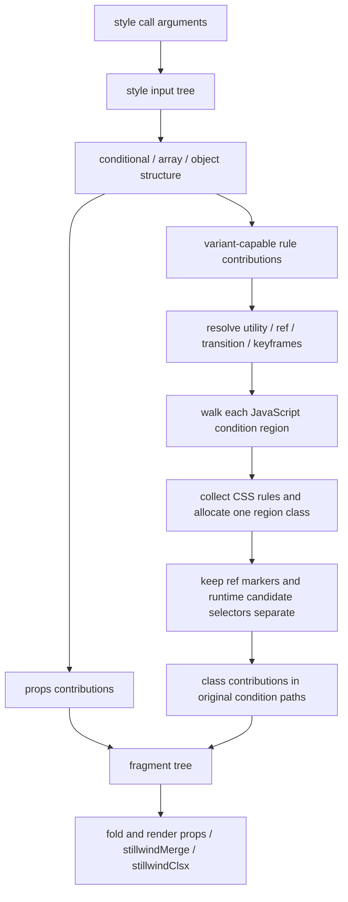

# `style()` input lowering design

`style()` is lowered as a source-ordered tree. Arrays, logical conjunctions, and
ternaries retain their evaluation boundaries. A CSS variant wraps a rule subtree;
it does not change where JavaScript tests run.

```text
StyleInput
├─ Array<StyleInput> / Conditional<StyleInput>
├─ Composition / RefAttachment / ViewTransitionUse
└─ Class(ClassExpression)
   ├─ Array<ClassExpression> / Conditional<ClassExpression>
   ├─ Group<GroupEntry>                  // may mix rule and props entries
   ├─ ClassValue                         // external class
   └─ Rule(RuleExpression)
      ├─ Array<RuleExpression> / Conditional<RuleExpression>
      ├─ Group<RuleExpression>
      ├─ Variant<RuleExpression>         // prefix, ref, or container wrapper
      └─ Rule leaf                       // utility / ref projection /
                                        // view transition / keyframes
```

`RuleExpression` is the recursive rule-only type. A variant stores only
`RuleExpression` children, so neither Rust construction nor deserialization can
place props-only leaves below it. `ClassExpression` keeps the root's mixed object,
external class, array, and conditional forms. The parser first classifies variant
values with the same input recognizers as root values, then converts only
rule contributions into `RuleExpression`; a props-only descendant makes that
conversion fail with `InvalidVariantInput`.
At every tree and emission level, `ConditionalBranches<T>` represents either
`And { consequent }` or `Ternary { consequent, alternate }`. The false branch
cannot be attached to a logical conjunction, including through deserialization.
`StyleInput::Array` carries mixed channels; arrays containing only class
expressions retain the existing `ClassExpression::Array` form for class folding.



## Input boundary

| Category            | Inputs                                                                                            | CSS variant wrapper |
| ------------------- | ------------------------------------------------------------------------------------------------- | ------------------- |
| Props contribution  | ref attachment marker, external `class`, inline custom property, `data-*` and `aria-*` attributes | No                  |
| Rule contribution   | utility, ref projection, view transition use, keyframes use                                       | Yes                 |
| Whole props payload | `style(base)` composition                                                                         | No                  |

The props-only inputs may occur under JavaScript conditionals and arrays at any
depth. A variant value may likewise contain arrays, conditionals, and nested
variants, provided all of its leaves are rule contributions. A ref projection
may generate a marker token as part of its class value; that does not turn a
ref _attachment_ into a variant-capable input.

Unresolved utility candidates retain their authored class token. The surrounding
variant wrapper does not become a literal prefix when resolution fails. A known
`group` or `peer` marker is also a class-only contribution.

## Effects and emission

A rule leaf resolves to ordered CSS declarations, dependency and symbol records,
and any runtime value needed to select its effect. Lowering walks every utility,
ref projection, transition use, and keyframes use in a JavaScript condition
region before allocating its CSS class. Rules without their own runtime identity
share that class, including rules reached through nested arrays and CSS variants.
The class remains in the original JavaScript condition path. A nested JavaScript
condition splits the surrounding region, so rules before and after it retain
their cascade order. CSS is published with the base unit before guarded
regions, retaining region order and declaration order.

Ref attachments and ref projection markers keep their own class tokens. A ref
projection's CSS rule uses the region class and a zero-specificity marker gate,
so several projections and utilities can share one CSS class while a dynamic
ref value still selects the appropriate declaration. Uses whose runtime value
selects a distinct transition or keyframes candidate may retain candidate
specific class identities.

A view transition use contributes to the element's `view-transition-class` list.
Guarded uses fill distinct custom-property slots so simultaneously true paths
contribute all of their tokens. A literal name is a CSS declaration. A dynamic
name without a CSS variant can be written directly as an inline
`view-transition-name` under its JavaScript guard. A dynamic name inside a CSS
variant needs a unique inline custom-property value and a variant-wrapped CSS
`view-transition-name: var(--slot)` declaration; writing the name property
inline would bypass the CSS variant. The generated property belongs to the
original JavaScript condition path, alongside its class contribution.

The fragment stage constructs the output from explicit class, custom-property,
attribute, style-payload, and composition contributions. A conditional arm with
only class contributions folds to a class expression through `stillwindClsx`.
A conditional arm that also supplies a dynamic style value remains a
`stillwindMerge` fragment. With no JavaScript condition, the contributions
materialize directly as framework props such as `{ className, style }`.
Folding may coalesce equivalent guards but must preserve evaluation order,
short-circuiting, and whole-payload overwrite rules.

For example, `style("flex mx-4", enabled && "mx-2", "hover:text-red")`
resolves unconditional rules into one base class and the guarded rule into a
second class. The output can use `stillwindClsx(base, enabled && guarded)`.
If the guarded leaf also carries a dynamic transition name, its output branch
must carry both the class and the name value.

For a dynamic name under `hover:`, the runtime fragment may contain two symbolic
records inside the same `enabled &&` arm: one for the generated class and one
for the generated custom property. `stillwindMerge` combines them into the
framework's class and style props. Keeping both records under that arm is the
required structural property; the fragment renderer may combine them further.

## Implementation invariants

- The source tree is the authority for JavaScript evaluation paths; CSS variants
  are the authority for selector and at-rule gating.
- CSS declarations, dependencies, generated identifiers, and runtime props are
  recorded as explicit lowering effects. A class token is never the sole record
  of a rule's side effects.
- Finite runtime candidates allocate CSS for every candidate. Ref projections
  select marker tokens through the original receiver value; transition and
  keyframes uses can select candidate classes. Unknown candidates keep the
  existing diagnostic rather than guessing a CSS effect.
- A finite candidate set may be empty when analysis proves no declaration is
  reachable. The parser omits empty transition and keyframes uses. Empty ref
  variants are diagnosed; other ref uses and composition can retain the runtime
  expression without static CSS candidates.
- Source spans remain in original UTF-8 coordinates. Callsite and branch identity
  remain in generated names to preserve stylesheet ordering semantics.
